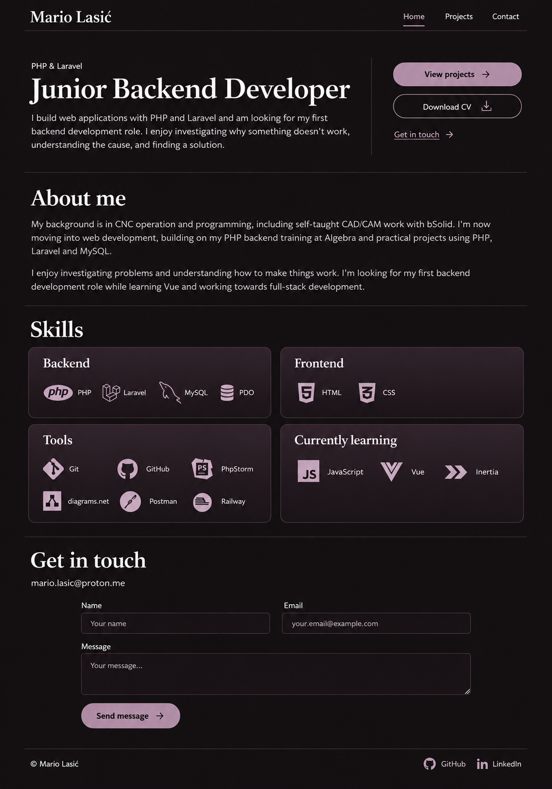
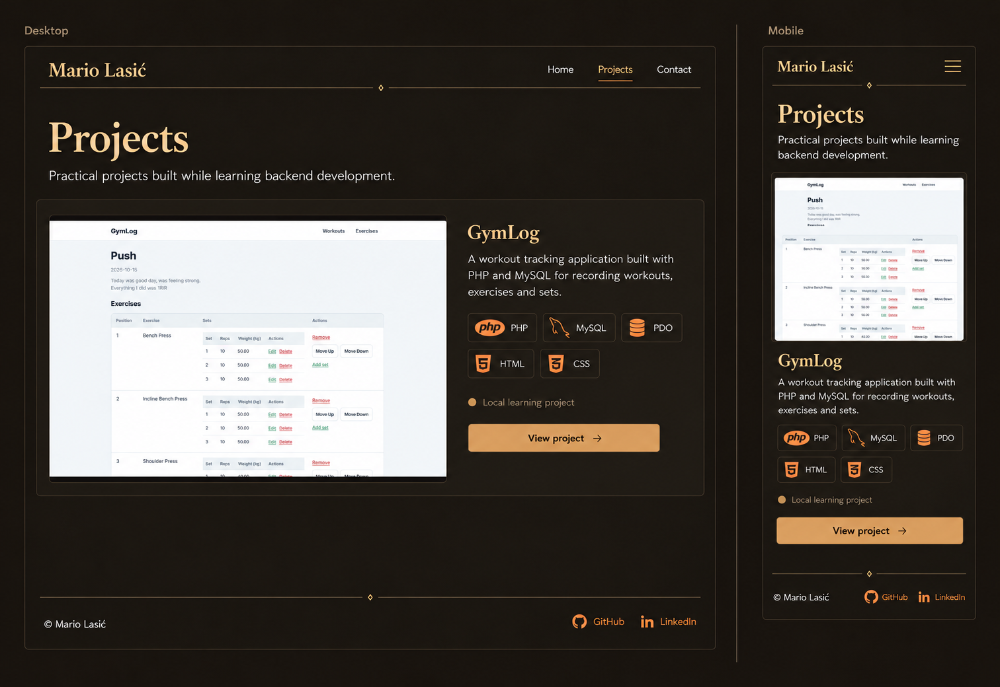
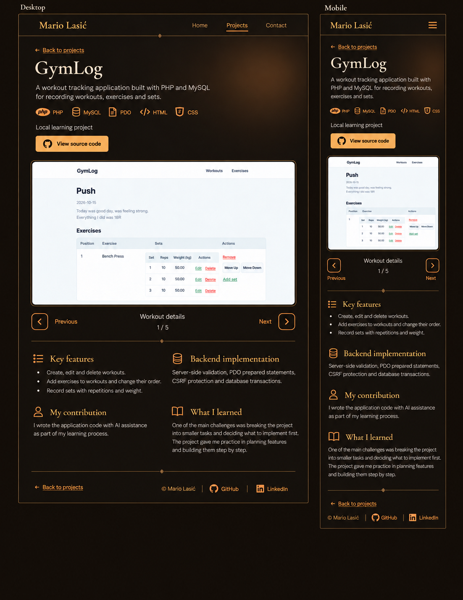
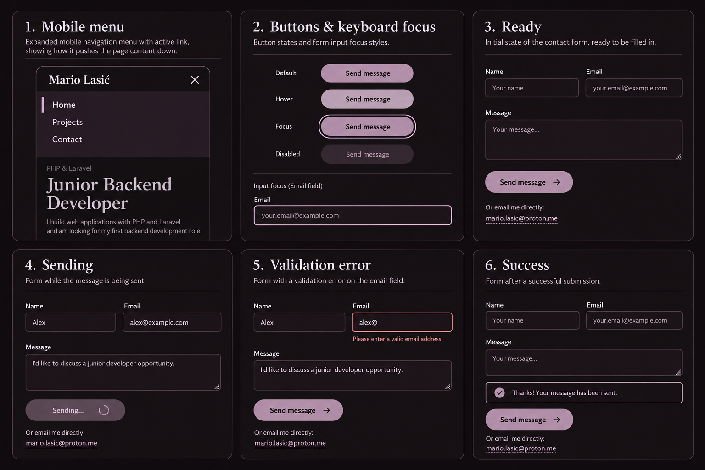

# Portfolio design

## Agreed direction

A modern dark portfolio with restrained Mauve Shadow accents, clear typography and generous spacing.
The layouts and colour direction were accepted on 19 October 2026. Small visual refinements will continue
when the pages are implemented.

The user also accepted the reference-led refinement shown below, including the rounded cards and buttons.
It is the agreed starting point for implementation; remaining small visual details will be resolved while building.

Use a near-black background. Start with `#141013` for the page and `#1D161B` for subtly raised surfaces;
the user is comfortable with either dark shade and will compare them during implementation.
Keep the page background solid and visually neutral. Mauve belongs on selected controls, icons and card
surfaces; the whole page should not have a purple glow or colour wash.

## References and sketches

- [Coolors: Mauve Shadow](https://coolors.co/tailwind/4b3b47), based on `#4B3B47`, provides the colour family.
- The user's three Coolors component screenshots clarify the finish: flat near-black panels, restrained
  mauve surfaces, rounded cards and pill-shaped buttons. The pricing-card examples guide the subtle
  top-to-bottom Skills gradient; their dashboard content is not part of the portfolio.
- [Wendo's portfolio](https://wendoj.vercel.app/) informed the prominent introduction and spacious composition.
- The home sketch below refines the accepted layout using the supplied component examples. It guides
  surface and card treatment; the exact starting colours are recorded above and in the palette table.
- The projects sketches further below preserve their accepted layouts in an earlier palette. Apply the
  current Mauve Shadow palette to those layouts during implementation.

## Palette

| Role | Hex |
| --- | --- |
| Starting page background | `#141013` |
| Alternative page background / subtly raised surfaces | `#1D161B` |
| Skills gradient: top | `#392D36` |
| Skills gradient: bottom | `#1D161B` |
| Quiet decorative borders | `#4B3B47` |
| Secondary control outline | `#725A6C` |
| Primary text and headings | `#F4F1F3` |
| Secondary text | `#D2C6CF` |
| Links and monochrome icons | `#BCA9B7` |
| Primary button background | `#A58D9F` |
| Text on filled primary buttons | `#141013` |
| Validation error text and borders | `#E6A1A8` |

Use the dark base colour for borders and surfaces, with lighter shades for text and interactive accents.
Keep all technology icons monochrome, matching the link colour, with readable names alongside them.

Calculated contrast ratios for the selected solid colours:

| Foreground | Page `#141013` | Surface `#1D161B` | Lightest card area `#392D36` |
| --- | --- | --- | --- |
| Primary text | 16.82:1 | 15.83:1 | 11.68:1 |
| Secondary text | 11.42:1 | 10.75:1 | 7.94:1 |
| Mauve accent | 8.53:1 | 8.03:1 | 5.93:1 |

Dark text on the filled mauve button has a calculated contrast of 6.21:1. Decorative borders are separate
from focus indicators; control states and focus will be specified in PORT-04.05 and checked on their actual
backgrounds during implementation.

## Typography

- **Headings:** [Cormorant Garamond](https://fonts.google.com/specimen/Cormorant+Garamond), weight 600.
  Fallbacks: Georgia and the generic serif family.
- **Body, navigation and controls:** [Source Sans 3](https://fonts.google.com/specimen/Source+Sans+3), weight 400
  for paragraphs and 600 for navigation and controls. Fallbacks: Arial and the generic sans-serif family.

Both families use the SIL Open Font License 1.1. Licence files:
[Cormorant Garamond](https://github.com/google/fonts/blob/main/ofl/cormorantgaramond/OFL.txt),
[Source Sans 3](https://github.com/google/fonts/blob/main/ofl/sourcesans3/OFL.txt).

| Element | Desktop | Mobile |
| --- | --- | --- |
| Main heading | 64 px | 42 px |
| Section heading | 40 px | 32 px |
| Project heading | 28 px | 24 px |
| Body text | 18 px | 16 px |

Start with a line height of 1.15 for headings and 1.65 for paragraphs. Check these values with real content
when building the pages.

## Spacing and surfaces

- Spacing scale: 8, 16, 24, 32, 48, 64 and 96 px.
- Maximum main content width: 1120 px.
- Side padding: 24 px on desktop and 20 px on mobile.
- Initial section spacing: 96 px on desktop and 64 px on mobile.
- Use quiet neutral dividers, starting at `#302930`, rather than bright accent rules across the page.
- Start with approximately 16 px corner radii on cards, following the supplied component examples.
- Use pill-shaped primary and secondary action buttons, with flat fills and fine outlines.
- Start with approximately 8 px corner radii on form fields.
- Skills cards use a subtle straight vertical gradient from `#392D36` at the top to `#1D161B` at the bottom.
- Keep the remaining page surfaces calm. The project introduction may have a faint mauve gradient on its
  right side, fading into the near-black background.
- Use restrained borders and shadows. Keep the focus on content and project screenshots.
- Keep broad page areas solid; confine the Skills gradients to their cards.

## Home page

### Mobile structure

1. Header with Mario Lasić's name and a menu button.
2. Full-width introduction with the agreed role and text from content.md.
3. Actions below the introduction: primary View projects, secondary Download CV and a quieter Get in touch
   link to the contact section.
4. About me using the agreed background and career-change text.
5. Skills in four groups: Backend, Frontend, Tools and Currently learning.
6. Contact form with Name, Email, Message, Send message and mario.lasic@proton.me.
7. Compact footer with copyright, GitHub and LinkedIn.

### Desktop structure

- Preserve the same section order.
- Place the introduction on the left and the action buttons in a separate column on the right.
- Show desktop navigation links in the header.
- Keep About text at a comfortable reading width.
- Arrange the four skills groups in a two-by-two grid.
- Centre the contact form; Name and Email may share a row above Message.
- Place copyright on the left and professional links on the right of the footer.

### Skills cards

- Stack four cards vertically on mobile and use a two-by-two grid on desktop.
- Keep headings and skill lists visible.
- Put recognisable technology icons beside their written names, using the same light mauve as links.
- Use consistently sized icons and the subtle top-to-bottom gradient specified above.
- The accepted sketch is the starting point. Refine icon size, internal spacing and card balance in
  PORT-06.02, then check the complete home page at multiple widths in PORT-06.04.

### Professional links

Include a GitHub icon beside GitHub and a LinkedIn icon beside LinkedIn in the shared footer on both screen
sizes. Icons and link text use light mauve, and the written names remain visible.

## Projects listing

The desktop and mobile listing layout was accepted on 19 October 2026. This sketch records its structure;
use the current palette above for colours.

- Shared header and footer, with Projects marked as the current page.
- Heading: Projects. Introductory sentence: Practical projects built while learning backend development.
- Repeatable wide project row: cover image left, summary right on desktop; image above summary on mobile.
- Include title, short description, technology labels with monochrome mauve icons, textual status and a
  View project link to the details page.
- For GymLog, use workout-details.png and the description from content.md. Its status is Local learning
  project, with no public demo.
- Preserve the source screenshot's landscape aspect ratio without stretching it.
- Add projects as equivalent rows underneath. Let row height follow content; long titles, descriptions and
  technology labels wrap naturally. Do not reserve empty controls for a missing demo link.

## Project details

The desktop and mobile details layout and manual carousel were accepted on 19 October 2026. This sketch
records structure; apply the current palette and a faint mauve introduction gradient.

1. Shared header, then Back to projects.
2. Project name, summary, technologies with monochrome icons, textual status and View source code.
3. One image carousel containing the project's screenshots. GymLog starts with Workout details and has
   five images in total.
4. Key features, Backend implementation, My contribution and What I learned: two-column pairs on desktop,
   stacked sections on mobile.
5. Back to projects near the shared footer.

Use manual Previous and Next controls, a visible caption and image counter, without automatic advancement.
Preserve image proportions and allow keyboard operation of the controls. Disable Previous on the first image
and Next on the last; hide unnecessary navigation when a project has only one image. The number of images
comes from the project data, and future projects use the same template.

Use the original screenshot files and approved descriptions from content.md. The generated sketches guide
layout and colour; they are not screenshot or logo assets for the application.

## Navigation and interactive states

The following behaviour and state board were accepted on 19 October 2026.

### Navigation destinations

| Link | Destination |
| --- | --- |
| Mario Lasić and Home | `/` |
| Projects and View projects | `/projects` |
| Contact and Get in touch | `/#contact`, including from project pages |
| A project's View project | `/projects/{slug}` |
| Back to projects | `/projects` |
| Download CV | `/files/mario-lasic-cv.pdf` |

Projects remains the active section on both the listing and the project-details pages. Identify the active
page with an underline or marker as well as colour.

### Mobile navigation

- Open a simple list of Home, Projects and Contact below the header, moving page content down.
- The toggle changes from a menu icon to a close icon and communicates its open or closed state.
- Close on a second toggle, link selection or Escape. Escape returns focus to the toggle.
- Keep the links in the normal keyboard tab order while open; hidden links must not receive focus.
- Keep this a straightforward expanding navigation list with ordinary links.

### Links, buttons and focus

- Primary button: `#A58D9F` with dark text; hover: `#BCA9B7` with dark text.
- Outline buttons retain their shape and gain a clearer mauve border or surface on hover.
- Text links retain a recognisable link treatment; hover brightens or underlines them.
- Keyboard focus uses a separate visible light-mauve outline, starting at 2 px thick with a 3 px gap.
  The focused state is distinguishable from hover and works on links, buttons and form controls.
- Unavailable controls have a muted appearance and cannot trigger their action. While a form request is
  running, the submit button is unavailable and its label changes to Sending….

### Contact form

| State | Feedback and behaviour |
| --- | --- |
| Ready | Show labelled Name, Email and Message fields and the Send message button. |
| Sending | Show Sending… and prevent a second submission while the request is running. |
| Validation error | Keep the entered values and show a specific error below the affected field, for example Please enter a valid email address. |
| Success | After the mail service accepts the request, show Thanks! Your message has been sent. and reset the fields. |
| Service or network failure | Keep all entered values and show Your message couldn’t be sent. Please try again or email me directly. |
| Rate limit | Keep entered values and show Too many attempts. Please wait before trying again. Respect any retry time returned by the server. |

Keep the alternative contact mario.lasic@proton.me available. Success means the mail service accepted the
request; it does not promise delivery to the recipient's inbox.

Validation errors use muted rose (`#E6A1A8`) with explicit text and an affected-field indicator. Success uses
clear text and a check indicator. Convey feedback without relying on colour alone, and announce dynamic
status changes to assistive technology. Preserve a visible keyboard focus throughout interaction.

These behaviours follow the [W3C disclosure-navigation example](https://www.w3.org/WAI/ARIA/apg/patterns/disclosure/examples/disclosure-navigation/)
and [W3C form-notification guidance](https://www.w3.org/WAI/tutorials/forms/notifications/).

## Implementation handoff

The design decisions are ready for implementation. Build the shared layout in PORT-05, the home page in
PORT-06, projects and their carousel in PORT-07, and the working contact flow in PORT-08. Continue small visual
refinements during implementation and verify behaviour on actual mobile and desktop layouts.
